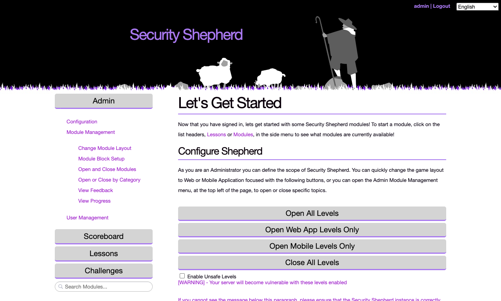
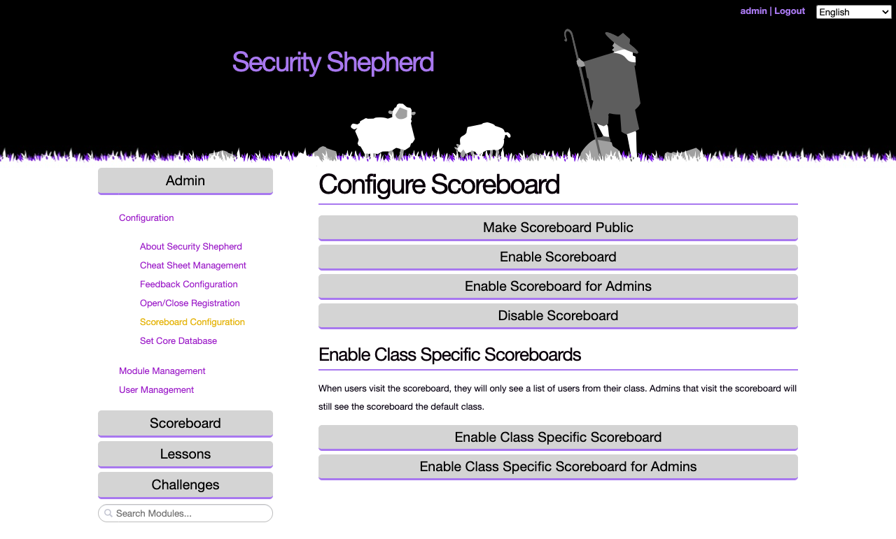
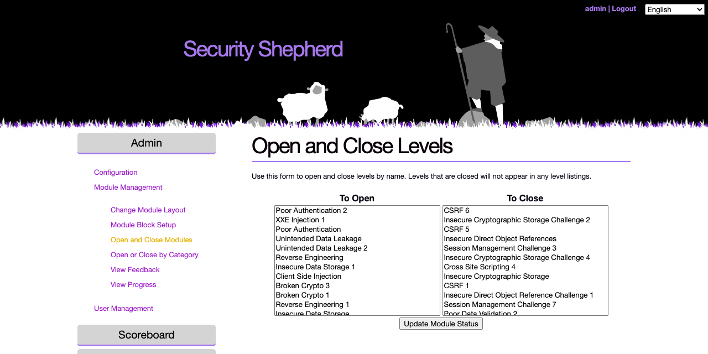
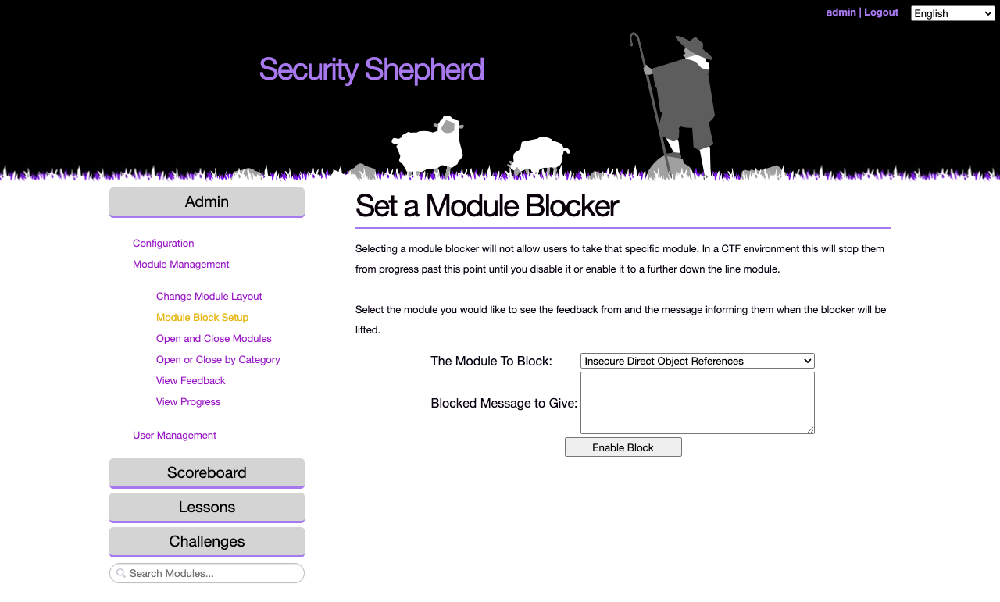
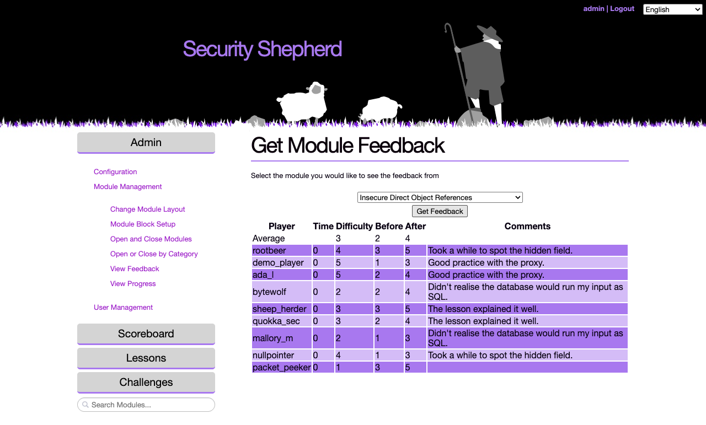

# Admin menu reference

This page describes every page in Security Shepherd's **Admin** menu, for organisers and administrators. To set up an event step by step, follow [Running a CTF](running-a-ctf.md) instead.

The **Admin** button at the top of the left-hand menu opens three sections: **Configuration**, **Module Management** and **User Management**. One section is open at a time.

Changes take effect immediately. Players may need to reload the page to see them.

## The start page

The start page that admins see, **Let's Get Started**, has a **Configure Shepherd** section with shortcuts for opening levels. To get back to it, reload the page.

| Button | What it does |
| --- | --- |
| **Open All Levels** | Opens every web and mobile level |
| **Open Web App Levels Only** | Opens the web levels and closes the mobile ones. This is the usual choice. |
| **Open Mobile Levels Only** | Opens the mobile levels and closes the web ones |
| **Close All Levels** | Closes every level |
| **Enable Unsafe Levels** | Tick it before clicking **Open All Levels** or **Open Web App Levels Only** to include the unsafe levels, which make the server itself vulnerable. Only do this on an isolated server. |

## Configuration

| Page | What it does |
| --- | --- |
| **About Security Shepherd** | Information about the project |
| **Cheat Sheet Management** | Turns on cheat sheets for administrators, or for everyone, or turns them off. While they're on, a **Cheat** button in the left-hand menu shows how to complete the open level. Turning them on for everyone gives the answers away. |
| **Feedback Configuration** | Makes players fill in a feedback form before a level is marked as complete. Read the answers in **View Feedback**. |
| **Open/Close Registration** | Lets people create their own accounts from the login page, or stops them. Players have to reload the login page to see the registration link. |
| **Scoreboard Configuration** | Who can see the scoreboard. See [below](#scoreboard-configuration). |
| **Set Core Database** | Changes the database server that Security Shepherd's `core` database is on. Only needed for an unusual database setup. |

### Scoreboard Configuration

| Button | Who sees the scoreboard |
| --- | --- |
| **Make Scoreboard Public** | Anyone, without logging in |
| **Enable Scoreboard** | Every logged-in user |
| **Enable Scoreboard for Admins** | Admins only |
| **Disable Scoreboard** | No one |
| **Enable Class Specific Scoreboard** | Logged-in players, who see only the players in their own class. Admins see the default class. |
| **Enable Class Specific Scoreboard for Admins** | Admins only, showing the class set in **Set Default Player Class** |

## Module Management

| Page | What it does |
| --- | --- |
| **Change Module Layout** | Chooses how levels are presented to players: CTF Mode, Open Floor Mode or Tournament Mode. [How Shepherd works](how-shepherd-works.md#finding-a-level) shows each one from a player's side. |
| **Module Block Setup** | Stops players from opening one level, with a message of your choosing. In CTF Mode, that stops them from going any further. See [below](#module-block-setup). |
| **Open and Close Modules** | Opens and closes individual levels. Closed levels don't appear in any player's menu. |
| **Open or Close by Category** | Opens and closes every level in a topic at once |
| **View Feedback** | The feedback players gave for a level. See [below](#view-feedback). |
| **View Progress** | How many levels each player in a class has completed. See [below](#view-progress). |

### Open and Close Modules

Select levels in the **To Open** list or the **To Close** list, then click **Update Module Status**. Hold Ctrl, or Cmd on a Mac, to select more than one.

### Module Block Setup

Choose the level to block and write the message players will see, such as when the block will be lifted, then click **Enable Block**. Use it to pause an event, for example to teach a topic before the levels that need it. Come back to this page to remove the block.

### View Feedback

Choose a level and click **Get Feedback**. The table shows each player's answers: how long they took, how hard they found it, how much they knew before and after, and their comments. The first row is the average.

Feedback is only collected while **Feedback Configuration** is on.

### View Progress

Choose a class and click **Get Progress** to see how many levels each player has completed. Use it to spot players who are stuck.

## User Management

A **class** is a group of players, such as the players at one event. Players in a class share a scoreboard when class-specific scoreboards are on, and medals and bonus points are awarded per class. Players without a class are listed as **Unassigned Players**.

| Page | What it does |
| --- | --- |
| **Add Players** | Creates a player account in a class. The password you set is temporary: the player changes it at their first login. |
| **Delete Players** | Deletes a player's account |
| **Add / Deduct Player Points** | Adds points to a player's score, or takes them away with a negative number. A player with a negative score doesn't appear on the scoreboard. |
| **Assign Players to Class** | Moves players into a class, or out of one |
| **Create Class** | Creates a class, with a name and a year |
| **Create New Admin** | Creates an admin account, with a temporary password |
| **Reset Password** | Sets a new temporary password for a player, which they change at their next login |
| **Set Default Player Class** | The class that players who register themselves join |
| **Suspend Player** | Stops a player from logging in for a number of minutes |
| **Undo Suspend Player** | Ends a suspension early |
| **Upgrade Player to Admin** | Makes a player an admin |
| **Downgrade Admin to Player** | Removes an admin's admin rights |
