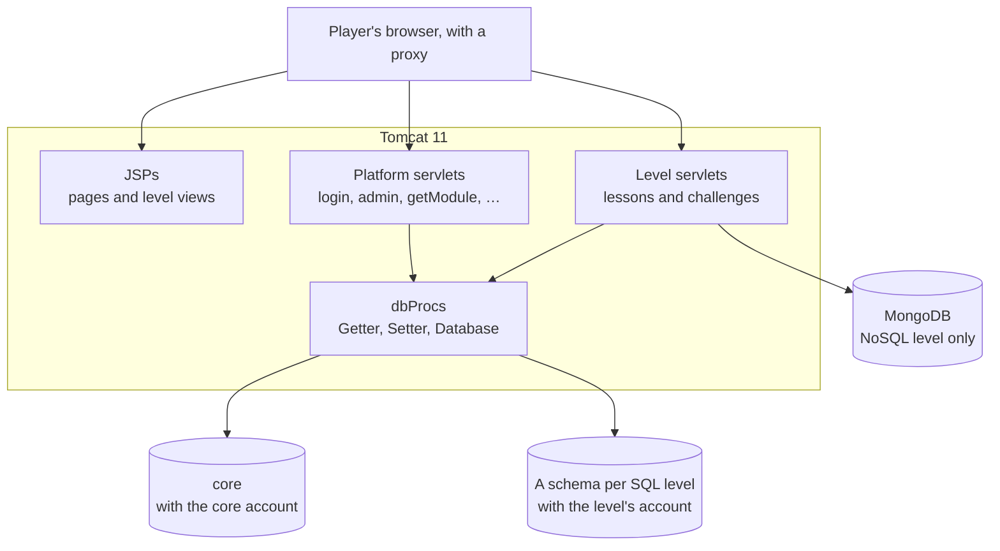
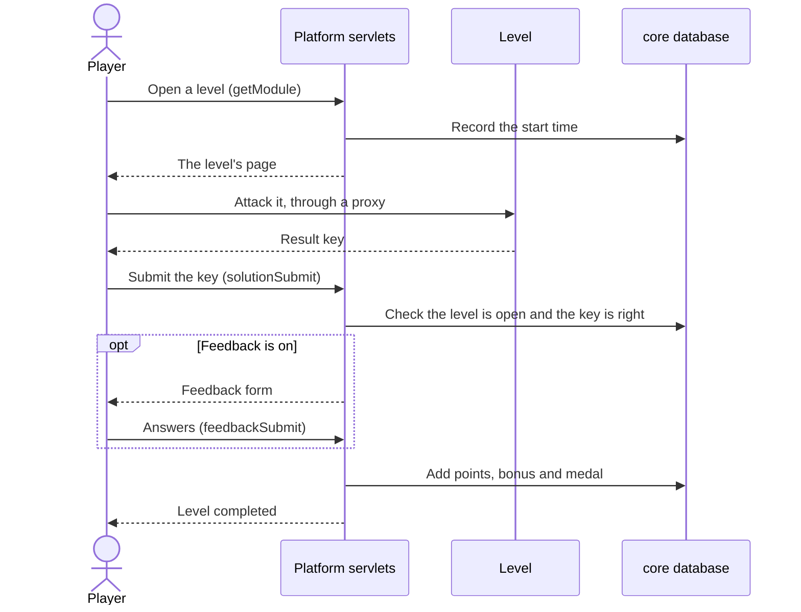

# Architecture

This page is for contributors. It describes how Security Shepherd is put together: the parts of the web application, how a player's request reaches a level, and how a completed level is scored. [Database layer](database-layer.md) goes further into the databases, and [Creating a level](creating-a-level.md) uses this page to add one.

## The parts

Security Shepherd is a Java web application, a WAR, that runs on Tomcat 11 with Jakarta EE 11 and Java 17. It keeps its data in MariaDB, plus MongoDB for one level. The mobile levels are separate Android apps in `mobile/MobileShepherd/`, and aren't covered here.

| Part | Where | What it does |
| --- | --- | --- |
| Platform servlets | `src/main/java/servlets/`, `servlets/admin/`, `servlets/module/` | Login and registration, setup, the scoreboard, the Admin menu, and the module framework that opens levels and checks result keys |
| Level servlets | `servlets/module/lesson/`, `servlets/module/challenge/` | The lessons and challenges. **Deliberately vulnerable:** don't fix them. |
| JSPs | `src/main/webapp/` | The platform's pages, the Admin pages in `admin/`, and each level's page in `lessons/` or `challenges/`, named after the level's hash |
| Utilities | `src/main/java/utils/` | Session and input validation, result key hashing, the cached settings (`ScoreboardStatus`, `ModulePlan`, `CountdownHandler`, …), logging, and single sign-on (`SamlSso`) |
| Database layer | `src/main/java/dbProcs/` | Connection pools, and the queries on `core`, mostly through stored procedures. See [Database layer](database-layer.md). |
| Text | `src/main/resources/i18n/` | Every string shown to players, in properties files, with a copy per language. See [Translating Security Shepherd](translating.md). |
| Schemas | `src/main/resources/database/` | `coreSchema.sql` (the platform's tables, stored procedures, levels and settings) and `moduleSchemas.sql` (the levels' schemas and accounts) |

Two classes run around every request. `SetupFilter` sends every request to the setup page until the database is configured. `listeners.DatabaseLifecycleListener` opens the connection pools when the application starts, and closes them when it stops.

## How a player completes a level

The start page, `index.jsp`, is a single page. Its menu asks the platform servlets for levels, and shows each level's page in a frame.

- **Opening a level.** `getModule` checks the level is open and returns the address of its page. The `moduleGetHash` stored procedure records when the player started it, which **View Feedback** uses to show how long each player took.
- **Result keys.** A level either has one fixed key for everyone, or a key of its own for each player. Per-player keys are made by `Hash.generateUserSolution` from the level's base key and the player's username. `solutionSubmit` makes the same key again to check a submission, so a key copied from another player fails. `hardcodedKey` in the level's database entry says which kind a level uses.
- **Scoring.** The `userUpdateResult` stored procedure adds the level's points, the bonus for the first five players in the class, and a medal for the first three. Wrong keys are counted by `userBadSubmission`. Players lose 10% of their score for each wrong key after the 40th.
- **Event times.** While the event is locked, completions are recorded with no points, and before the start or after the end, levels can't be opened or submitted. See [Event times](configuration.md#event-times).

## Settings and state

The Admin menu's settings are stored in the `settings` table of `core`, and each is cached in a class in `utils/` the first time it's read: `ScoreboardStatus`, `ModulePlan` (the layout), `OpenRegistration`, `CheatSheetStatus`, `FeedbackStatus` and `CountdownHandler`. The Admin pages update both the table and the cache, so a change made directly in the database needs a Tomcat restart.

The module block is the exception: `ModuleBlock` keeps it in memory only, so restarting Tomcat removes it. [Configuration](configuration.md#settings-in-the-database) lists the settings.

Sessions are Tomcat's own HTTP sessions. Every form and request that changes something carries a CSRF token, which the platform servlets check with `Validate.validateTokens`.

## Building and running

| Command | What it makes |
| --- | --- |
| `mvn clean package -DskipTests` | `target/owaspSecurityShepherd.war`, for your own Tomcat. See [Manual setup](manual-setup.md). |
| `mvn -Pdocker clean install -DskipTests` | The WAR, plus the SQL and MongoDB scripts the Docker images need |
| `docker compose up -d --build` | The three containers described in [Getting started](getting-started.md#whats-running) |

[Development workflow](development-workflow.md) and [Running tests](testing.md) cover the rest of the development cycle.
