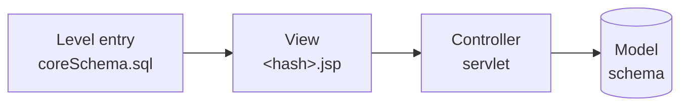

# Creating a level

This page is for contributors who want to add a web level: a lesson or a challenge. Read [Architecture](architecture.md) first for how levels are opened and scored. Mobile levels are being reworked separately and aren't covered here.

A level is a small application with a vulnerability in it, deliberately. Keep the vulnerability inside the level: a player who exploits it must not be able to reach the platform, other levels' data or the server. If a level can't avoid that, it must be marked unsafe.

## The pieces of a level

The entry makes the level appear in the menu, and opens its view. The view sends the player's requests to the controller, which queries the model with the level's own database account. The table lists every piece, including those that sit beside this chain.



| Piece | Needed for |
| --- | --- |
| Level entry | Every level: its ID, name, topic, result key, rank and points |
| View | Every level: the page the player sees |
| Controller | Levels with server-side behaviour to attack. A level whose key is hidden in the page itself needs none. |
| Model | Levels that use a database |
| Cheat sheet | Every level |
| Test | Every level with a controller |

## 1. Register the level

Run Security Shepherd locally, as described in [Getting started](getting-started.md), on a branch named for your issue (see [Development workflow](development-workflow.md)).

Create the level in your local database with the `moduleCreate` stored procedure:

```bash
docker exec -it secshep_mariadb mariadb --skip-ssl -uroot -p core
```

```sql
-- Name, 'lesson' or 'challenge', topic, whether the key is the same for everyone,
-- and that key (or NULL to have one generated)
CALL moduleCreate('SQL Injection 8', 'challenge', 'Injection', false, NULL);
```

Use an existing topic where one fits, spelt exactly as in the level catalogue's database entries (`Injection`, `XSS`, `CSRF`, …). The procedure returns the level's ID, its hash, and the translation keys for its name and topic. Keep them: the hash names the level's files, and the ID names its cheat sheet.

Pass `false` and `NULL` for a level that gives each player a key of their own, which is the usual case. Pass `true` and the key only when the key has to be the same for everyone, for example when it's hidden in a file the level serves.

Then turn the level into a line for `coreSchema.sql`, so new installations get it:

```sql
SELECT CONCAT("INSERT INTO modules (`moduleId`, `moduleName`, `moduleNameLangPointer`, `moduleType`, `moduleCategory`, `moduleCategoryLangPointer`, `moduleResult`, `moduleHash`, `moduleStatus`, `incrementalRank`, `scoreValue`, `hardcodedKey`, `isUnsafe`) VALUES ('", moduleId, "', '", moduleName, "', '", moduleNameLangPointer, "', '", moduleType, "', '", moduleCategory, "', '", moduleCategoryLangPointer, "', '", moduleResult, "', '", moduleHash, "', 'open', '", incrementalRank, "', '", scoreValue, "', ", hardcodedKey, ", ", isUnsafe, ");")
FROM modules WHERE moduleName = 'SQL Injection 8';
```

Add the output to `src/main/resources/database/coreSchema.sql` with the other `INSERT INTO modules` lines, then edit three values in it:

- **`incrementalRank`** (`200` by default): the level's place in CTF Mode's order and its [tournament band](levels.md). Compare it with the levels around it in difficulty.
- **`scoreValue`** (`50` by default): the points it's worth. Harder levels are worth more.
- **`isUnsafe`** (`1` by default): set it to `0` unless the level makes the server itself vulnerable. Unsafe levels stay closed unless an admin opens them on purpose.

Add the level's name and, for a new topic, the topic's name to `src/main/resources/i18n/moduleGenerics/moduleNames.properties`, using the translation keys `moduleCreate` returned. Topic keys start with `category.`:

```properties
sql.injection.8 = SQL Injection 8
category.injection = Injection
```

## 2. Create the view

Copy `src/main/webapp/webLevelTemplate.jsp` to `src/main/webapp/challenges/<hash>.jsp`, or `lessons/<hash>.jsp` for a lesson, using the level's hash. In it:

- Set `levelName` to the level's English name. It's used in the logs.
- Set `levelHash` to the hash.
- Point `ResourceBundle.getBundle(…)` at the properties file with the level's text, for example `i18n.challenges.injection.<hash>`, and put every string the page shows in that file, in `src/main/resources/i18n/challenges/…`. Don't write English into the JSP. [Translating Security Shepherd](translating.md) explains the files.
- Describe what the player has to do. A lesson also explains the vulnerability in plain language and gives hints. A challenge doesn't.
- If the level has a controller, use the template's form and JavaScript examples to send requests to it, at an address built from the hash, such as `<hash>` or `<hash>Search`, so it can't be guessed.

The level now opens from the menu, once it's open in **Admin → Module Management → Open and Close Modules**.

## 3. Create the controller

Copy `src/main/java/servlets/module/ModuleServletTemplate.java` into `servlets/module/challenge/` or `servlets/module/lesson/`, rename the class, and:

- Set `levelName`, `levelHash` and, for a level that gives each player their own key, `levelResult` to the level's key (`moduleResult` in its database entry).
- Read the player's input, and put the deliberately vulnerable logic where the template says "Template Users: Edit from here".
- When the player succeeds, return `Hash.generateUserSolution(levelResult, userName)`, as the template does, so each player gets a key of their own. A level with one key for everyone returns that key.
- Put the text the servlet returns in a properties file under `src/main/resources/i18n/servlets/`.

Map the servlet in `src/main/webapp/WEB-INF/web.xml`, next to the other levels, at the address the view sends to:

```xml
<servlet>
    <servlet-name>/challenges/HASH</servlet-name>
    <servlet-class>servlets.module.challenge.SqlInjection8</servlet-class>
</servlet>
<servlet-mapping>
    <servlet-name>/challenges/HASH</servlet-name>
    <url-pattern>/challenges/HASH</url-pattern>
</servlet-mapping>
```

## 4. Create the model

A level that uses a database gets a schema of its own and a database account that can only read what the level needs. A player who breaks the level with SQL injection can then reach nothing else.

Add the schema and its data to `src/main/resources/database/moduleSchemas.sql`, and the account at the end of the file, like the others:

```sql
GRANT USAGE ON *.* TO 'sqlChalEight'@'localhost' IDENTIFIED BY 'password';
DROP USER 'sqlChalEight'@'localhost';
CREATE USER 'sqlChalEight'@'localhost' IDENTIFIED BY 'a long random password';
-- Grant only what the level needs. A player who finds an injection gets these rights too, so
-- avoid INSERT, UPDATE and DELETE unless the level can't work without them.
GRANT SELECT ON `SqlChalEight`.`users` TO 'sqlChalEight'@'localhost';
```

Add the account's details in `src/main/resources/challenges/SqlChalEight.properties`:

```properties
databaseConnectionURL=SqlChalEight
databaseUsername=sqlChalEight
databasePassword=a long random password
```

In the controller, connect with `Database.getChallengeConnection(applicationRoot, "SqlChalEight")`, the file's name without `.properties`. It reuses the server address from `database.properties` and gives the level a small connection pool of its own. Close every connection, statement and result set with try-with-resources.

## 5. Add the cheat sheet

Admins can show players how to complete a level, so every level needs its steps. Add a line for the level's ID to `coreSchema.sql`, with the other `cheatSheetCreate` calls:

```sql
CALL cheatSheetCreate('LEVEL_ID', 'LEVEL_ID.solution');
```

and the steps to `src/main/resources/i18n/cheatsheets/solutions.properties`:

```properties
LEVEL_ID.solution = Steps to complete the level
```

## 6. Update the level catalogue

[The levels](levels.md) is generated from `coreSchema.sql`. Regenerate it, and commit the result:

```bash
uv run --locked --no-sync python .github/scripts/generate-level-catalogue.py
```

A level in an existing topic needs nothing more. A new topic needs an entry in `.github/scripts/level-classification.toml`, with its name, OWASP Top 10 category and CWE, or the generator stops and says so. The docs CI fails if the catalogue is out of date.

## 7. Test it

Write an integration test in `src/it/java/servlets/module/challenge/` or `lesson/`, like `SqlInjectionLessonIT.java`: it runs the level's servlet against a real database, and checks that the attack returns the key and that a wrong input doesn't. Then run the whole pipeline locally before you push, as [Running tests](testing.md) and AGENTS.md describe.

Finally, check the level from a fresh installation: rebuild with `mvn -Pdocker clean install -DskipTests`, recreate the database volume, run setup, open the level and complete it.
