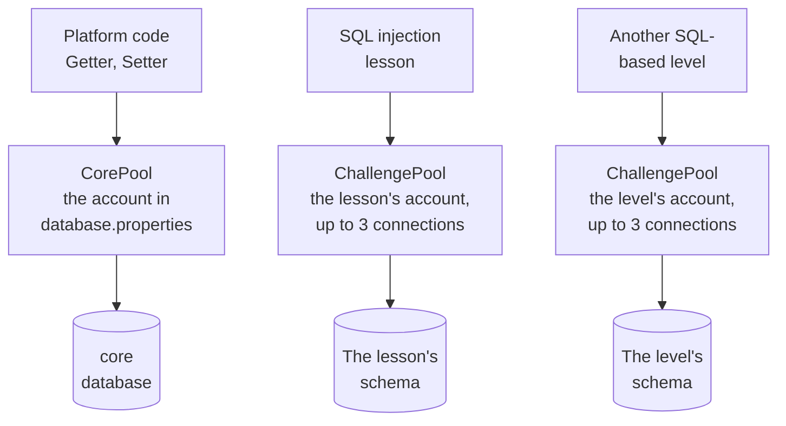

# Database layer

This page is for contributors. It describes how Security Shepherd connects to its databases, and why. The settings an operator can change are listed in [Configuration](configuration.md).

## Overview

Security Shepherd uses two databases:

- **MariaDB** holds the `core` database (users, classes, levels, results and settings) and a separate schema for each SQL-based level.
- **MongoDB** holds the data for the NoSQL injection level.

The code is in `src/main/java/dbProcs/`:

| Class | What it does |
| --- | --- |
| `Database` | Hands out connections: to `core`, and to each level's schema with that level's own account |
| `ConnectionPool` | The HikariCP pools behind those connections |
| `Getter`, `Setter` | Read and write queries on `core`, mostly through stored procedures |
| `MongoDatabase` | The shared MongoDB client |
| `Constants` | Paths, such as where `database.properties` is |
| `FileInputProperties` | Reads properties files |

The `core` schema and its stored procedures are in `src/main/resources/database/coreSchema.sql`, and the levels' schemas in `moduleSchemas.sql`.

## One database account per level

Each SQL-based level connects with a database account that can only reach that level's schema. The account's credentials are in a properties file in `src/main/resources/challenges/`, which `Database.getChallengeConnection` reads. A player who breaks a level with SQL injection can only reach what that level could reach anyway.

Keep it that way: don't consolidate the levels' accounts, and don't give a level the `core` account.

In Tomcat, the platform and each level get a connection pool of their own, and each pool connects to MariaDB with its own account:



## Why connection pooling?

Without a pool, every database operation opens a TCP connection, authenticates, runs the query and closes the connection. Opening a connection can take 20 to 50 ms, which adds up quickly when a class of players works at once.

| Benefit | Description |
| --- | --- |
| **Performance** | Connections are reused, so a request doesn't pay to open one |
| **Resource use** | The pool caps the number of connections, so the database isn't overloaded |
| **Validation** | The pool checks a connection before handing it out, which catches stale ones |
| **Tuning** | The pool's size and timeouts can be set for the event |
| **Monitoring** | The pool reports its active, idle and waiting connections |

| Drawback | Description |
| --- | --- |
| **Memory** | Idle connections use memory on both Tomcat and the database server |
| **Sizing** | Too small a pool makes requests wait, and too large a pool wastes resources |
| **Leaks** | Code that doesn't close its connections can exhaust the pool |
| **Stale connections** | A firewall or the database may drop a connection that's idle for long |
| **Debugging** | Connection problems are harder to trace through a pool |

Pooling helps Security Shepherd most when many players work at once: opening levels, submitting keys, and refreshing the scoreboard.

## Implementation

### MariaDB: HikariCP

[HikariCP](https://github.com/brettwooldridge/HikariCP) provides the pools:

- **`CorePool`** for the `core` database, sized by the `pool.*` properties in `database.properties`.
- **`ChallengePool-<user>`** for each level's account, created the first time the level is used. Each has at most 3 connections, keeps none idle, and closes idle connections after 2 minutes, so the many levels don't hold connections open between uses.

Every pool tests a connection with `SELECT 1` before handing it out, and caches prepared statements.

Always close connections, statements and result sets, with try-with-resources. A connection that isn't closed stays checked out of its pool, and after `pool.leakDetectionThreshold` (60 seconds by default) HikariCP logs a warning with the stack trace of the code that took it.

### MongoDB: one shared client

The MongoDB Java driver pools connections itself, so `MongoDatabase` creates a single `MongoClient` and reuses it across the application. Its pool size comes from `pool.connectionsPerHost` and `pool.minConnectionsPerHost` in `mongo.properties`.

## Lifecycle

`listeners.DatabaseLifecycleListener`, registered in `web.xml`, manages the pools:

1. **When the application starts,** it creates the core pool. On a fresh installation `database.properties` doesn't exist yet, so this fails: the listener logs the error and the application starts anyway. The pool is then created by the first request that needs a connection, after the setup page has written the file.
2. **When the application stops,** it closes every pool and the MongoDB client, so Tomcat can redeploy the application without leaking connections.

## Monitoring

`ConnectionPool.getPoolStats()` describes the core pool:

```java
String stats = ConnectionPool.getPoolStats();
// Pool: CorePool, Active: 2, Idle: 8, Total: 10, Waiting: 0
```

The pools log at these levels:

- **INFO:** the pools are created or closed.
- **DEBUG:** each pool's settings when it's created.
- **WARN:** a `pool.*` property isn't a number, so its default is used. HikariCP also logs its own warnings, such as a suspected connection leak.
- **ERROR:** a pool can't be created, or `database.properties` can't be read.

## Troubleshooting

### Pool exhaustion

If requests fail with `Connection is not available`:

1. Look for connection leaks: the leak detection warnings show where a connection was taken.
2. Raise `pool.maximumPoolSize`.
3. Check `pool.connectionTimeout`.

### Slow connections

If getting a connection is slow:

1. Check the database server's health.
2. Check the network between Tomcat and the database.
3. Raise `pool.minimumIdle`, so more connections are open before they're needed.

### Validation failures

If connections fail validation:

1. Check the database server is running.
2. Check the credentials in `database.properties`.
3. Check Tomcat can reach the database. In Docker, use the container name, not `localhost`.
