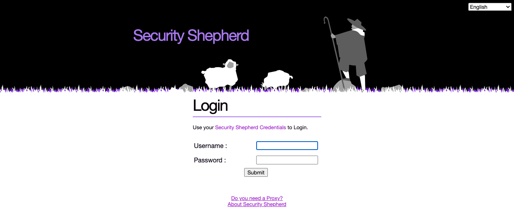
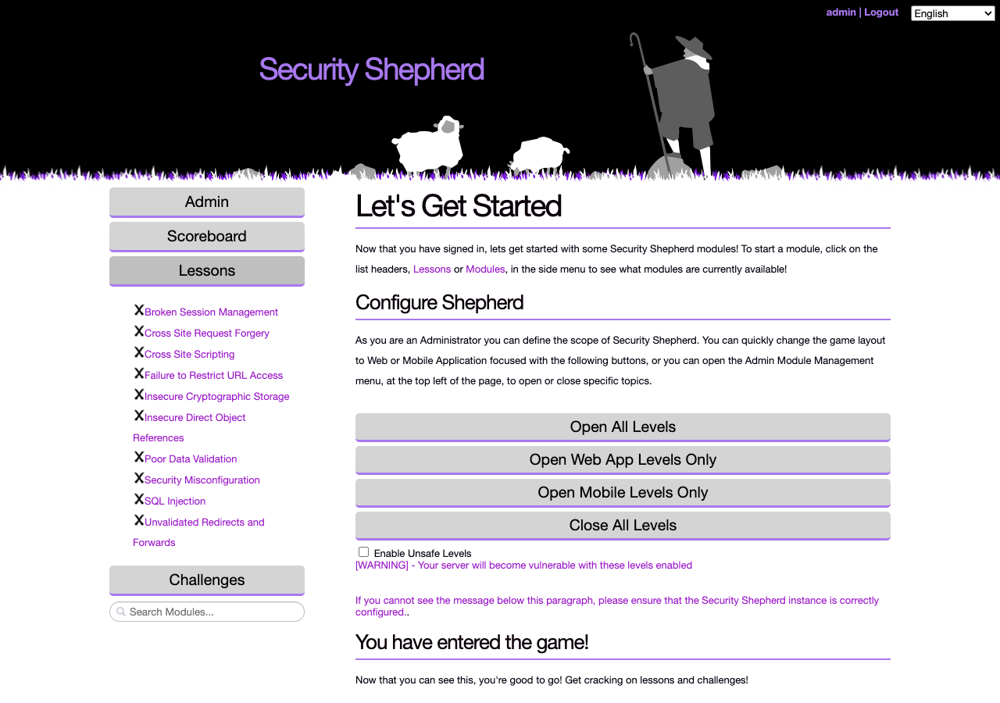
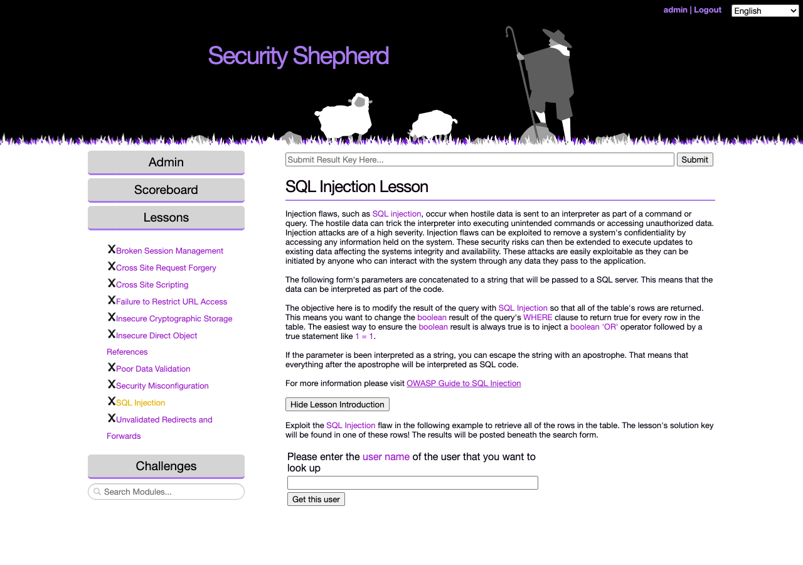

# Getting started

Security Shepherd is a capture-the-flag (CTF) platform for learning web and mobile application security. Most of its levels are based on the [OWASP Top 10](https://owasp.org/www-project-top-ten/). Each topic starts with a lesson that explains the vulnerability, followed by challenges that get harder as you go.

This page gets Security Shepherd running on your own machine with Docker, takes you through the first login, and shows you how to try the levels. To run an event for other people, continue with [Running a CTF](running-a-ctf.md).

## Run it with Docker

You need Git, JDK 17, Maven 3.9.2 or newer, and Docker with Docker Compose.

```bash
git clone https://github.com/OWASP/SecurityShepherd.git
cd SecurityShepherd

# Build the WAR and generate the database scripts the images need
mvn -Pdocker clean install -DskipTests

# Build the images and start the containers
docker compose up -d --build
```

The [README](https://github.com/OWASP/SecurityShepherd#readme) covers the Docker setup in more detail, including using your own TLS certificate and upgrading an existing installation.

This setup is a quick start for a laptop or a classroom lab, not a production deployment. It uses well-known default passwords and a self-signed certificate. [Running a CTF](running-a-ctf.md#before-you-start-secure-the-deployment) lists what to change before other people use it.

### What's running

Docker Compose builds three images and starts a container from each:

| Container | Image | What it does |
|---|---|---|
| `secshep_tomcat` | `owasp/security-shepherd` | The web application, on Tomcat 11. Serves HTTPS on port 443 and redirects HTTP on port 80 to it. |
| `secshep_mariadb` | `owasp/security-shepherd_mariadb` | The `core` database, with users, scores and settings, plus a separate schema for each SQL-based level. Listens on `127.0.0.1:3306` only. |
| `secshep_mongo` | `owasp/security-shepherd_mongo` | MongoDB, for the NoSQL levels. Listens on `127.0.0.1:27017` only. |

The ports come from `.env`, along with the passwords and the container names.

Data is kept in Docker volumes, so it survives `docker compose down` and rebuilds. The volume names start with the Compose project name, which is the name of the folder you cloned into, for example `securityshepherd_data`.

| Volume | Holds |
|---|---|
| `data` | The MariaDB databases |
| `conf` | Tomcat's configuration, the TLS keystore, and the database connection settings (`database.properties` and `mongo.properties`) |
| `logs` | Tomcat's logs |
| `mongodata`, `mongoconfig` | The MongoDB data and configuration |

## First-time setup

Open [https://localhost](https://localhost). Your browser warns about the certificate, because it's self-signed. On a fresh installation, Security Shepherd shows the **No Database Configuration** page.

1. Get the setup authentication token from the Tomcat container and paste it into **Authentication token**:

    ```bash
    docker exec secshep_tomcat cat /usr/local/tomcat/conf/SecurityShepherd.auth
    ```

2. Fill in the database settings. Tomcat reaches the databases over the Docker network, so use the container names, not `localhost`:

    | Field | Value |
    |---|---|
    | Hostname, Port | `secshep_mariadb`, `3306` |
    | DB Username, DB Password | `root`, and the `DB_PASS` from `.env` (`CowSaysMoo` unless you changed it) |
    | Override Databases | **Fresh Database** for a new installation. **Do not override** keeps the existing data, for example after you've recreated the `conf` volume. |

3. To include the NoSQL injection level, tick **Enable NoSQL Challenge**, and enter `secshep_mongo` and `27017` in the MongoDb **Hostname** and **Port** fields that appear.

4. Leave **Enable Unsafe Challenges** off unless the machine is isolated, because those challenges make the server itself vulnerable.

5. Submit the form, and wait for the confirmation that the database configuration is complete.

## Log in

Log in with:

- username: `admin`
- password: `password`



You're asked to change the password straight away, because the default one is public. You can also change the username, which is shown on the scoreboard.

## Try the levels

You need an intercepting proxy, such as [OWASP ZAP](https://www.zaproxy.org/) or [Burp Suite Community Edition](https://portswigger.net/burp/communitydownload). Both come with a preconfigured browser.

The levels start closed. As an admin, the start page (**Let's Get Started**) has a **Configure Shepherd** section. To get back to it, reload the page.



1. Click **Open Web App Levels Only**. The mobile levels need an Android setup, which this guide doesn't cover. Tick **Enable Unsafe Levels** first only if the machine is isolated.
2. To see every open level at once, grouped by topic, go to **Admin → Module Management → Change Module Layout** and click **Enable Open Floor Mode**. [Running a CTF](running-a-ctf.md#choose-a-layout) describes the other layouts.
3. Pick a lesson from the menu on the left. When you complete a level, you get a result key. Paste it into the **Submit Result Key Here** box to score the level.



To see how to complete a level, go to **Admin → Configuration → Cheat Sheet Management** and click **Enable Cheat Sheets for Administrators**. Then reload the page. A **Cheat** button appears in the left menu, and shows the cheat sheet for the level that's open. It gives the answer away, so leave cheat sheets off if you want the challenge.
