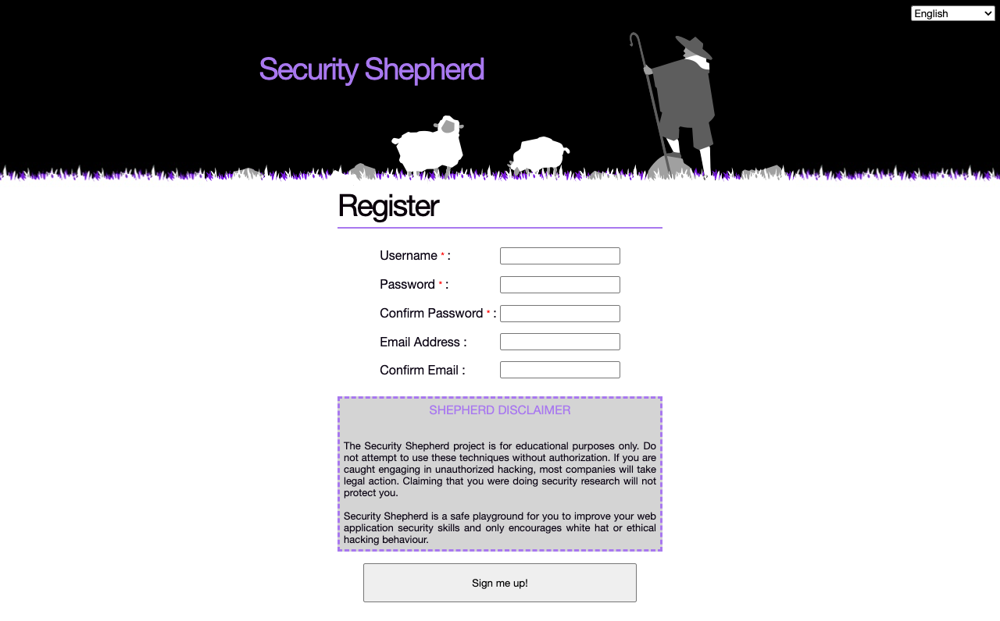
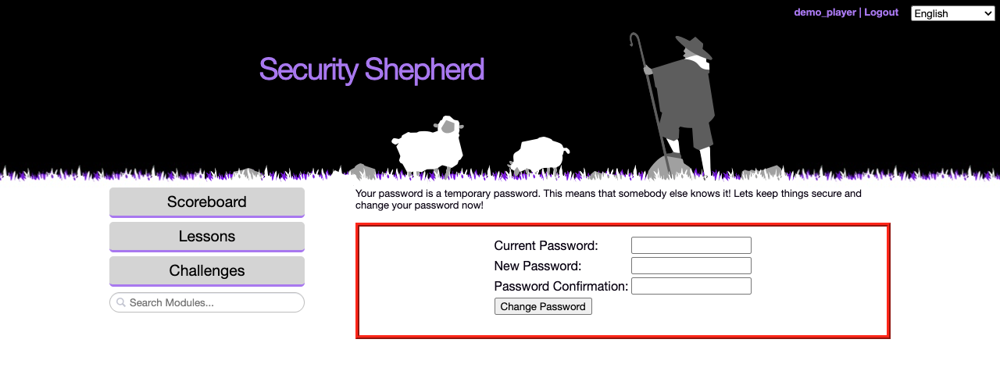
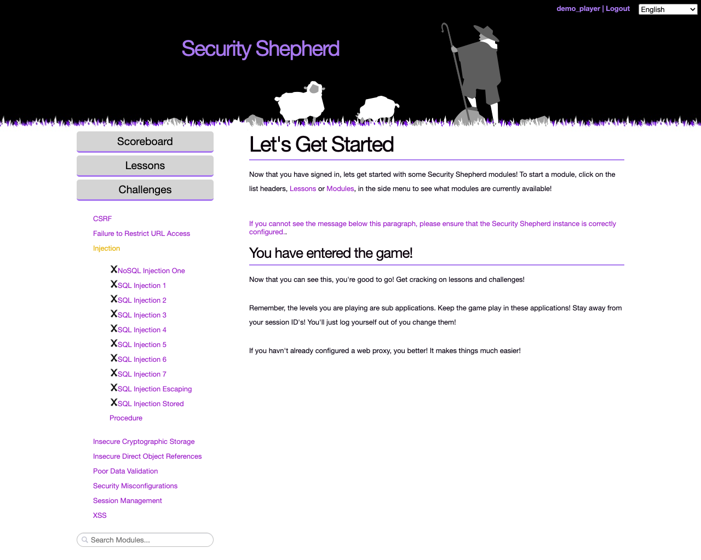
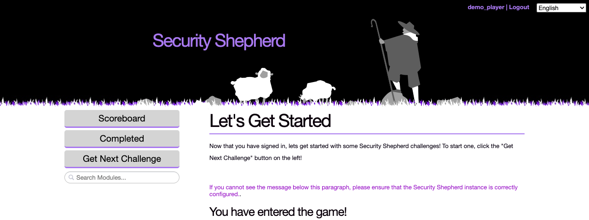
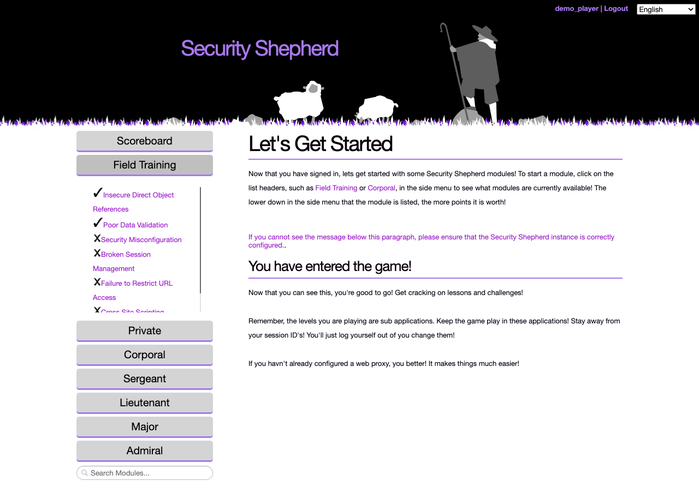
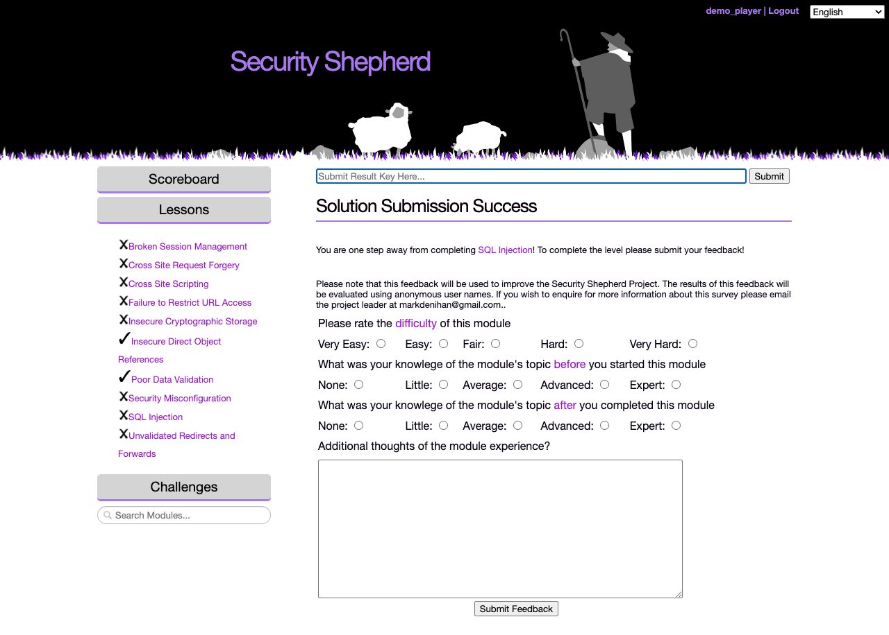

# How Shepherd works

This page is for players: what you'll see when you log in, how to find and complete levels, and how scoring works. Organisers can read it to see the game from a player's side. Running an event is covered in [Running a CTF](running-a-ctf.md).

## Lessons and challenges

Security Shepherd's levels come in two kinds:

- **Lessons** explain one kind of vulnerability in plain language, then give you a small application to try it on. Start with these if a topic is new to you.
- **Challenges** give you an application with that vulnerability and no instructions. They get harder as you go, and the later ones need you to combine what you've learned.

Each topic, such as SQL injection or cross-site scripting, has a lesson and several challenges. Most topics come from the [OWASP Top 10](https://owasp.org/www-project-top-ten/). [The levels](levels.md) lists them all.

## Your account

Your organiser either opens registration, so you can create your own account, or creates one for you.

To register, click the registration link on the login page. Choose a username, which is shown on the scoreboard, and a password. The email address is optional.

If your organiser created your account, or reset your password, the password you were given is temporary. You'll be asked to change it when you log in, before you can play:

If you log in through your organisation's single sign-on, you're offered the chance to change your username, which is what the scoreboard shows. It's optional.

## Finding a level

The menu on the left lists the levels your organiser has opened. How they're arranged depends on the layout your organiser chose.

**Open Floor.** Every open level is available, with the lessons under **Lessons** and the challenges under **Challenges**, grouped by topic. A ✓ marks the levels you've completed and an ✗ the ones you haven't.

**CTF Mode.** You see one level at a time. Click **Get Next Challenge** for the next one you haven't completed, and **Completed** to see the ones you've done. The levels get harder slowly and move between topics.

**Tournament Mode.** Every open level is available, grouped into bands from easiest to hardest: Field Training, Private, Corporal, Sergeant, Lieutenant, Major and Admiral. Levels in higher bands are worth more points.

In every layout, the **Search Modules** box under the menu finds a level by name.

## Completing a level

Each level has a goal, such as reading another user's data or running a script in someone else's browser. When you reach it, the level gives you a **result key**. Paste the key into the **Submit Result Key Here** box at the top of the page and click **Submit**.

Many levels give each player a key of their own, so another player's key won't work for you.

If your organiser has turned on feedback, you're asked a few questions about the level before it's marked as complete: how hard it was, and how much you knew about the topic before and after. Organisers use the answers to see what the class understood.

## Scoring

- Each level is worth a fixed number of points, and harder levels are worth more.
- In your class, the first five players to complete a level get bonus points: 5 for the first, down to 1 for the fifth.
- The first three also win a gold, silver or bronze medal, shown next to their name on the scoreboard.
- Wrong result keys cost nothing at first. After your 40th wrong submission, each further wrong key takes 10% off your score, so don't guess keys with automated tools.

The **Scoreboard** button opens the scoreboard, if your organiser has turned it on.

## What you need

- **A web browser and an intercepting proxy,** such as OWASP ZAP or Burp Suite. Most levels are much easier with a proxy, and some can't be done without one. [Setting up your tools](setting-up-your-tools.md) explains how.
- **For the CSRF challenges, another player.** A CSRF challenge is only completed when another logged-in player triggers the request you forged, so you'll need to get someone else to visit your page.
- **For the mobile levels, an Android emulator.** See [Mobile levels](mobile-levels.md).

## Rules

Your organiser sets the rules for an event, but these always apply:

- **Attack the levels, not the platform.** The login, registration, result key submission, scoreboard and admin pages are out of scope. If you find a vulnerability in the platform itself, tell your organiser instead of using it.
- **Don't break the levels for other players,** for example by deleting the data a level needs.
- **Don't share answers.** Explaining a concept is fine. Handing over a result key or a working attack isn't.
- **Only attack systems you're allowed to.** What you learn here is for testing systems you have permission to test.

The language menu at the top right of every page changes the language of the platform's pages, as far as they're translated. The levels are shown in English for now. See [Translations](translations.md).
