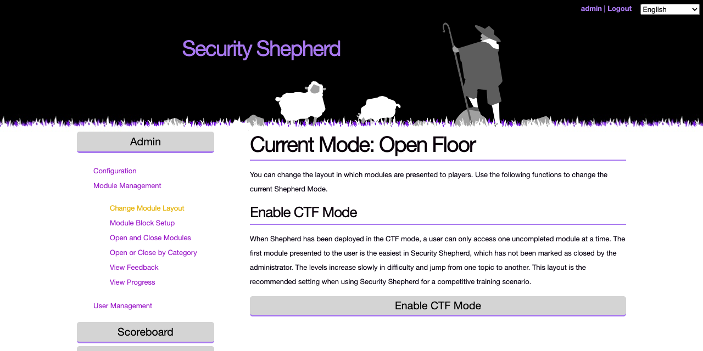
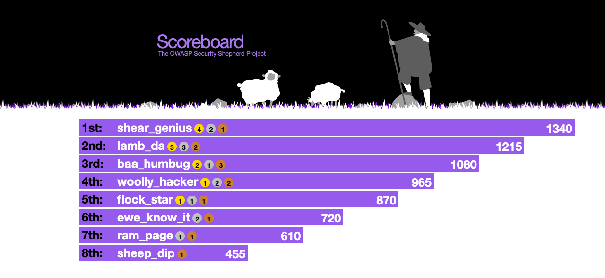

# Running a CTF

This guide is for organisers running Security Shepherd as a capture-the-flag event, for a class, a team or a conference. It assumes you have an installation running and have logged in as `admin`, as described in [Getting started](getting-started.md).

Most settings are in the **Admin** menu on the left. Changes take effect immediately, and players may need to reload the page to see them.

## Before you start: secure the deployment

The Docker Compose setup is a quick start. Before other people use it, change the following:

- **Database password.** Set `DB_PASS` in `.env` before you first run `docker compose up`.
    - MariaDB applies the root password only when it creates the `data` volume.
    - The Tomcat image copies `DB_PASS` into its connection settings when it's built ([#814](https://github.com/OWASP/SecurityShepherd/issues/814)), and the `conf` volume keeps that copy from the first start.
    - To change the password later, change MariaDB's root password and `databasePassword` in `database.properties` in the `conf` volume.
    - Because the password is inside the image you built, don't push that image to a public registry.
- **TLS.** Replace the self-signed certificate with your own, as the [README](https://github.com/OWASP/SecurityShepherd#https-certificate) describes, and set `TLS_KEYSTORE_PASS` in `.env`.
- **Admin accounts.** The default `admin` password is public, and you're asked to change it at the first login. Every organiser should log in and change their own temporary password before the event.
- **Network.** Security Shepherd is deliberately vulnerable. Run it on a network that's only for the event.
    - The Compose file binds MariaDB and MongoDB to `127.0.0.1`, so they aren't reachable from other machines. Keep it that way.
    - Leave the unsafe levels closed unless the server is isolated, because they make the server itself vulnerable.

## Choose the levels

All levels start closed. On the start page, **Configure Shepherd** has buttons to open all levels, only the web levels or only the mobile levels, and to close everything. To get back to the start page, reload the page.

- **Open Web App Levels Only** is the usual choice. The mobile levels need players to set up Android tooling.
- **Enable Unsafe Levels** opens levels that make the server vulnerable. Use it only on an isolated server.
- **Admin → Module Management → Open and Close Modules** and **Open or Close by Category** let you choose individual levels or whole topics.

Some levels need more than a browser and a proxy, so check them before you open them:

- The CSRF challenges are only completed when *another* logged-in player triggers the forged request, so players have to persuade someone else to visit their page. Some of them also need the player to host a page on a server they control.
- The unsafe levels expose the server, as above.

Try the levels yourself first, with cheat sheets enabled for administrators, so that you can help players who get stuck.

## Choose a layout

**Admin → Module Management → Change Module Layout** decides how levels are presented:

| Layout | How it works | Good for |
|---|---|---|
| **CTF Mode** | Players see one uncompleted level at a time, starting with the easiest. Difficulty rises slowly and moves between topics. | Guided training, where everyone follows the same path |
| **Open Floor Mode** | Every open level is available, grouped by vulnerability category, with the lessons first. | Self-paced learning, where players explore topics |
| **Tournament Mode** | Every open level is available, grouped into difficulty bands from easiest to hardest. | Competitions |

The page shows the current mode, with a button to switch to each of the others:



**Admin → Module Management → Module Block Setup** stops players from going past a chosen level and shows them a message of your choosing. Use it to pause an event, for example to teach a topic before the levels that need it, and remove the block when you're ready.

## Players, classes and admins

Group the players of one event into a class, so they share a scoreboard. The options are under **Admin → User Management**.

1. **Create Class** for the event.
2. **Set Default Player Class**, so that everyone who registers joins that class automatically. Use **Assign Players to Class** for accounts that already exist.
3. **Create New Admin** for each organiser, or **Upgrade Player to Admin** for an existing account.

Also under User Management:

- **Add Players** creates an account in a class you choose, if you don't want open registration.
- **Reset Password**, **Suspend Player** and **Undo Suspend Player** deal with problem accounts.
- **Add / Deduct Player Points** lets you award points by hand, for example for helping other players.

## Registration, scoreboard and feedback

These options are under **Admin → Configuration**.

- **Open/Close Registration.** Open it when you're ready for players to sign up. Players have to reload the login page to see the registration link. Consider closing registration once everyone has an account, so players can't create a second account to complete the CSRF challenges on their own.
- **Scoreboard Configuration.** Make the scoreboard public, show it to logged-in users or to admins only, or turn it off. **Enable Class Specific Scoreboard** shows players only their own class, which keeps the event's scoreboard separate from anyone else on the server.
- **Cheat Sheet Management.** Cheat sheets show how to complete each level. Enable them for administrators so you can help players. Enabling them for all users gives the answers away.
- **Feedback Configuration.** Makes players submit a feedback form before a level is marked as complete. It's useful for collecting what students understood. Read the feedback under **Admin → Module Management → View Feedback**, and follow each class's progress under **View Progress**.

## Scoring



- Each level is worth a fixed number of points, and harder levels are worth more.
- In each class, the first five players to complete a level get a bonus on top: 5 points for the first, 4 for the second, down to 1.
- The first three also win a gold, silver or bronze medal on the scoreboard.
- Wrong result keys cost nothing at first. After a player's 40th wrong submission, each further wrong key takes 10% off their score. This discourages guessing keys with automated tools.

You can add your own awards with **Add / Deduct Player Points**.

## Settings in the database

The settings are stored in the `settings` table of the `core` database. To see them all:

```bash
docker exec -it secshep_mariadb mariadb -uroot -p core -e 'SELECT * FROM settings'
```

To make `admin` change its password again at the next login:

```bash
docker exec -it secshep_mariadb mariadb -uroot -p core -e "UPDATE users SET tempPassword = 1 WHERE userName = 'admin'"
```

## Rules for players

Publish rules before the event. A starting point:

- **Stay ethical.** The levels are for education only. Don't use what you learn against systems you're not authorised to test.
- **Attack the levels, not the platform.** The login, registration, result key submission, scoreboard and admin pages are out of scope. If you find a vulnerability in the platform itself, report it to the organisers instead of using it.
- **No automated scanners.** They slow the server down for everyone, and repeated wrong result keys cost points.
- **Help each other.** Explain concepts and share techniques, but don't share answers.

## Things to know

- **XSS levels.** These levels decide whether an XSS attack worked by checking the submitted input for known attack patterns, not by detecting that a script ran. Occasionally a payload that does pop an alert isn't recognised. If a player shows you one that works, help them find a variant the level accepts.
- **Reskinning.** The logo and styles are in [`src/main/webapp/css/`](https://github.com/OWASP/SecurityShepherd/tree/dev/src/main/webapp/css) (`theCss.css`, and `images/shepherd_and_sheep_v2.png`). Change them, then rebuild the WAR and the image as in [Getting started](getting-started.md#run-it-with-docker). Changes made inside a running container are lost when it's recreated.
