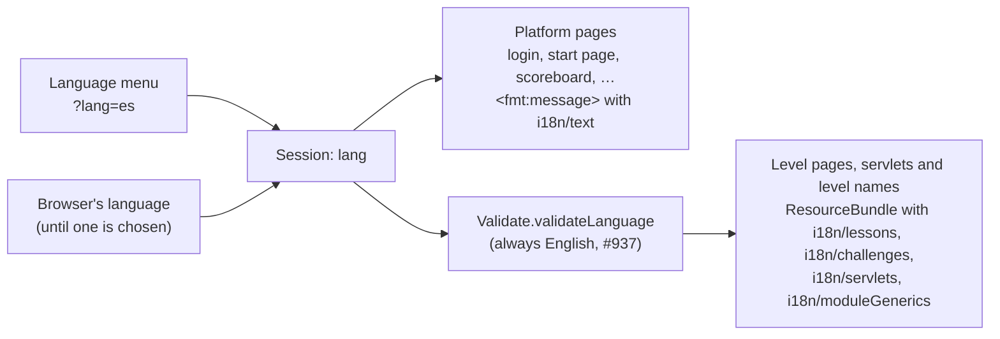

# Translating Security Shepherd

This page is for contributors who want to help translate Security Shepherd. There are two kinds of work:

- **Making text translatable** (for developers). Much of Security Shepherd's English is still written directly into its pages and servlets, including every Admin page and every message the server sends back. That text has to be moved into translation files before anyone can translate it. See [Make text translatable](#make-text-translatable).
- **Translating** (for anyone who knows a language). Translating the text that's already in translation files, or adding a language.

[Translations](translations.md) describes what players and organisers see today.

## How a page gets its language



- **Platform pages** include `translation.jsp`, which stores the chosen language in the session and reads their text from `i18n/text.properties` with JSTL's `<fmt:message>`.
- **Level pages, their servlets and the level names in the menu** load their properties files with `ResourceBundle`, in the language `Validate.validateLanguage` returns. That method currently returns English for every language, so they're always shown in English, whatever's chosen ([#937](https://github.com/OWASP/SecurityShepherd/issues/937)). Their translation files are kept and still worth improving: they'll be shown once that's fixed.

A string missing from a translation is shown in English.

## The files

The text is in `src/main/resources/i18n/`, in Java properties files. Each English file has a copy per language, with the language's [ISO 639-1 code](https://en.wikipedia.org/wiki/List_of_ISO_639-1_codes) added to its name: `text.properties` is English, `text_es.properties` Spanish, `text_ga.properties` Irish.

| Files | Text |
| --- | --- |
| `text.properties` | The platform's pages and menus |
| `moduleGenerics/moduleNames.properties` | Level and topic names in the menus |
| `lessons/<topic>/<hash>.properties` | Each lesson's page |
| `challenges/<topic>/…properties` | Each challenge's page |
| `servlets/…` | Text the levels' servlets return, and error messages |
| `cheatsheets/solutions.properties` | The cheat sheets |

Each line is a key and its text:

```properties
title.question.xss = What is Cross Site Scripting (XSS)?
```

Keep the key as it is, and translate only the text after `=`. Keep any HTML in the text, such as `<a>` or `&lt;`, and placeholders such as `{0}`. Save files as UTF-8. Older files use escapes such as `中`, which also work.

## Improve a translation

1. Find the English file for the page and its copy for your language. If there's no copy yet, copy the English file and add the language code to its name.
2. Translate the text, or add the keys that are missing from the copy.
3. Check it: run Security Shepherd locally, as in [Getting started](getting-started.md), choose your language in the menu, and look at the page.
4. Open a pull request, as described in [Development workflow](development-workflow.md).

To see which keys a language is missing, compare it with the English file. For example, for Spanish:

```bash
cd src/main/resources/i18n
diff <(grep -o '^[^#=]*=' text.properties | tr -d ' ' | sort) \
     <(grep -o '^[^#=]*=' text_es.properties | tr -d ' ' | sort)
```

## Add a language

1. Translate `text.properties` into `text_<code>.properties`. The platform's pages are what every player sees, so start there.
2. Add the language to the menu in `src/main/webapp/translation-select.jsp`, in its own language:

    ```jsp
    <option value="it" ${lang == 'it' ? 'selected' : ''}>Italiano</option>
    ```

3. Translate `moduleGenerics/moduleNames.properties`, the level names in the menu. They'll be shown once [#937](https://github.com/OWASP/SecurityShepherd/issues/937) is fixed.
4. Add the language to the table in [Translations](translations.md).

## Make text translatable

This is the bigger job. As of 4.0, this text is still in the code:

| Where | Files |
| --- | --- |
| Every Admin page | `src/main/webapp/admin/**/*.jsp`: none of the 24 use a translation file. Only the Admin menu's labels, in `index.jsp`, do. |
| Every message from an admin action, such as "Class created" | `src/main/java/servlets/admin/**/*.java`: none of the 36 use a translation file |
| Messages from the platform's servlets, such as login and registration errors | `src/main/java/servlets/*.java`: only `Setup` uses a translation file |
| The scoreboard and error pages | `scoreboard.jsp`, `lostSheep.jsp`, `serverError.jsp` |
| Some sentences on otherwise translated pages | The platform's JSPs |

To move text into a translation file:

1. Add a key and the English text to the right properties file: `text.properties` for platform and Admin pages, or the servlet's file under `i18n/servlets/`.
2. Replace the English in the code with a lookup of that key:
    - **A platform or Admin page** includes `translation.jsp` (`<%@ include file="translation.jsp"%>`, with the right relative path) and shows text with `<fmt:message key="your.key" />`. Admin pages are loaded into the start page, but each is a JSP of its own, so each needs the include.
    - **A level page** loads its bundle as `webLevelTemplate.jsp` does, `ResourceBundle.getBundle("i18n.challenges.<topic>.<hash>", locale)`, and shows text with `bundle.getString("your.key")`.
    - **A servlet** loads its bundle with the locale from `Validate.validateLanguage(request.getSession())`, as `ModuleServletTemplate.java` does, and returns `bundle.getString("your.key")`. Until [#937](https://github.com/OWASP/SecurityShepherd/issues/937) is fixed, that locale is always English.
3. Check the page still reads the same in English, and that a language with the key shows it.

Name keys after where the text appears, such as `title.question`, `paragraph.info.1` or `button.hideIntro`, so the page still reads clearly with only keys in it.

New pages, levels and servlets shouldn't add English to the code at all. Put every string in a translation file from the start.
