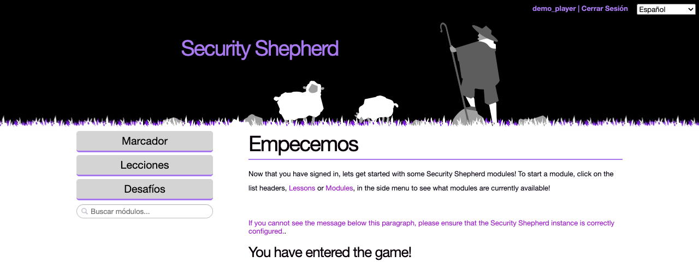

# Translations

Security Shepherd has a language menu with eight languages, but only part of the application can be translated so far, and only part of that has been. In practice, players see a mix of their language and English, and the Admin pages are only in English. This page explains what to expect. To help translate it, see [Translating Security Shepherd](translating.md).

## Choosing a language

The menu at the top right of the platform's pages, including the login page, sets the language: English, Español, Français, Português, Gaeilge, 中文, Hindi (Hinglish) or Русский. Until a player picks one, Security Shepherd uses their browser's language, if it's one of these. The choice lasts until they log out or close the browser.

## What can be translated

Text can only be translated once it has been moved out of the code into a translation file. A lot of Security Shepherd's English is still written directly into its pages and servlets, where no translation can reach it.

| Part | Can it be translated? |
| --- | --- |
| Login, registration, setup and start pages, and the menu's headings | Yes, mostly. Some sentences are still in the code. |
| Levels, and their names in the menu | Yes, but they're always shown in English for now, because of a bug ([#937](https://github.com/OWASP/SecurityShepherd/issues/937)). A few levels have translations, most of them in Chinese. |
| Admin pages | No. None of them use translation files yet. Only the Admin menu's labels can be translated. |
| Messages from the server, such as login errors and the confirmations after an admin action | No. They're in the code. |
| The scoreboard and the error pages | No |

## How much has been translated

Of the text that's in translation files, this is how much each language has. It doesn't include the levels, or anything that can't be translated yet.

| Language | Code | Translated |
| --- | --- | --- |
| English | `en` | The original |
| Español | `es` | About 30% |
| Français | `fr` | About 55% |
| Português | `pt` | About 70% |
| Gaeilge | `ga` | About 40% |
| 中文 | `zh` | About 70% |
| Hindi (Hinglish) | `hi` | About 70% |
| Русский | `ru` | All of it |

Anything missing from a translation is shown in English.

There's no setting to turn translations off. The `enableTranslations` setting in the database isn't used.

## Helping with translations

There's a lot to do, in two kinds of work: moving the remaining English out of the code into translation files, which needs a developer, and translating the files, which doesn't. [Translating Security Shepherd](translating.md) covers both.
